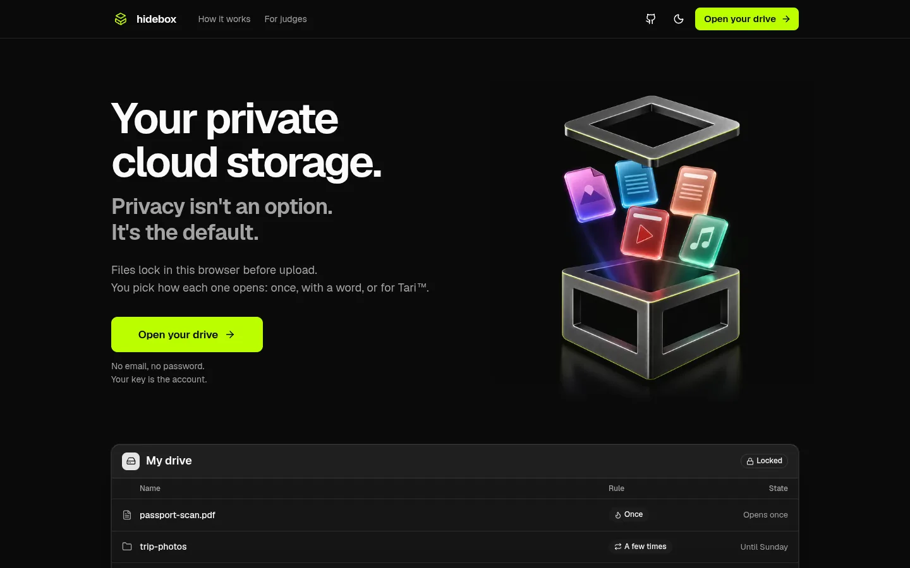
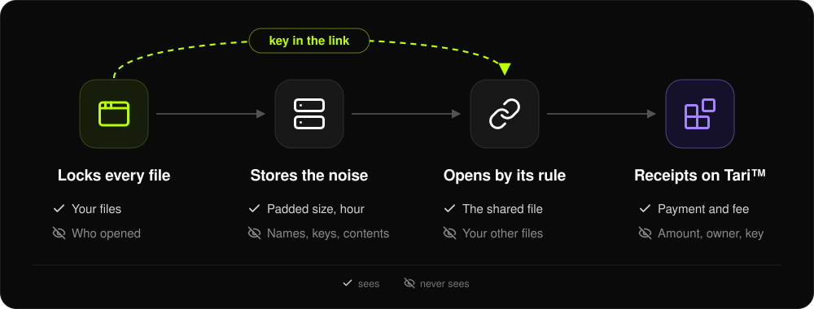

<!-- SPDX-License-Identifier: MIT -->
<div align="center">

<h1></h1>

**Your private cloud storage. Store, send, and sell files privately.**<br>
Built on Tari™. No KYC. No email.

[**Open your drive**](https://hidebox.app) · [For judges](https://hidebox.app/judges) · [How it works](https://hidebox.app/how) · [Docs](docs/README.md)

[](https://hidebox.app/status.json)

[](LICENSE)

</div>

<a href="https://hidebox.app"></a>

## Try it in 2 minutes

1. Open [hidebox.app](https://hidebox.app) and tap **Open your drive**. No email, no password.
2. Drop in a file, then **Share**, keep **Once**, and **Make link**.
3. Open the link in a private window, then reload it: "This link has ended."

Both judge tracks, step by step: [/judges](https://hidebox.app/judges). The long tour: [docs/overview.md](docs/overview.md).

## How it works

Files lock in your browser first. You pick how each file opens: once, with a word, or for Tari.



## Exit rules

| Rule | It opens |
|---|---|
| **Once** | one time, then the link ends |
| **A few times** | up to 3 times |
| **Until a date** | until tomorrow, or for a week |
| **Public link** | until you stop it |
| **Secret word** | with the link and the word |
| **One Tari address** | only for that address |
| **Pay to open** | once they pay your Tari address |
| **Delete it after** | by its rule; when the link ends, the file leaves your drive too |

## Run it yourself

```sh
git clone https://github.com/c7b/hidebox && cd hidebox
python3 -I tools/build.py --config deploy/config/mutis.toml.example --origin http://127.0.0.1:8787 --web web --out /tmp/mutis-dist --release /tmp/mutis-release
python3 -I server/bin/mutis-api --dev --data /tmp/mutis-dev --dist /tmp/mutis-dist --port 8787 --pow-bits 10
python3 -m webbrowser http://127.0.0.1:8787   # --dev fakes the wallet, indexer and chain: every flow runs offline
```

## Docs

[Privacy](docs/privacy.md) · [Tari](docs/tari.md) · [Architecture](docs/architecture.md) · [Threat model](docs/threat-model.md) ·
[API](docs/api.md) · [Self-host](docs/self-host.md) · [Verify and test](docs/verify.md) · [Fix log](docs/review/fix-log.md) ·
[Security](SECURITY.md) · [Contributing](CONTRIBUTING.md)

## License

MIT ([LICENSE](LICENSE), [NOTICE](NOTICE)). Built with AI coding agents under the author's direction.

Built on the Tari™ Ootle testnet. tTARI is the coin on Tari's test network. It is worth nothing.
**hidebox** is an independent project, not affiliated with, endorsed by, or sponsored by Tari Labs, the Tari
Council, or the Tari project. "Tari" is a trademark of Tari Labs. All rights reserved.
